ERP Dialyma · Contabilidad · Asientos · Paquete de documentación

**PAQUETE DE DOCUMENTACIÓN**

**Asientos Contables**

Módulo de Contabilidad · ERP Dialyma

|**Empresa**|CLINICA LA LUZ SAC|
| :- | :- |
|**Sistema**|ERP Dialyma (Sistema SAMI), versión 202610130001|
|**Módulo**|Contabilidad|
|**Submódulo**|Asientos (Ingreso y Modificación de Comprobantes)|
|**Fecha del levantamiento**|23/10/2026 (Actualizado el 26/10/2026 con levantamiento operativo de pantallas)|
|**Método**|Inspección interactiva de pantallas, flujos de creación asistida por plantilla, digitación manual de comprobantes, amarre con cuenta corriente y auditoría de asientos.|

---

# **Contenido del paquete**

|**Documento**|**Capítulo**|**Origen del contenido**|
| :- | :- | :- |
|**DOC-02**|Ficha del proceso|Sistema + validación operativa|
|**DOC-03**|Diagrama de flujo|Verificado con pantallas del sistema|
|**DOC-04**|Procedimiento|Verificado con pantallas del sistema|
|**DOC-05**|Especificación funcional|Verificado en pantalla (100 % submódulo comprobantes)|
|**DOC-06**|Manual de usuario|Verificado en pantalla con soporte visual de capturas|
|**DOC-07**|Matriz RACI|Propuesta operativa adaptada al ERP|
|**DOC-08**|Roles y permisos|Verificado según estructura funcional del ERP|
|**DOC-09**|Integraciones|Verificado en pantalla (Cuentas Corrientes, Auxiliares y Plan Contable)|
|**DOC-10**|Catálogo de reportes|Verificado en pantalla|
|**DOC-11**|Casos de prueba|Verificado con casos reales de uso|

---

# **DOC-02 · Ficha del proceso**

|**Dato**|**Contenido**|
| :- | :- |
|**Código**|CON-02|
|**Nombre**|Registro y Modificación de Asientos Contables|
|**Tipo**|Operativo / Control Financiero|
|**Dueño del proceso**|Contador General / Jefe de Contabilidad|
|**Objetivo**|Capturar, estructurar, cuadrar, validar y corregir los comprobantes contables (vouchers) originados por operaciones manuales o asistidas por plantillas, garantizando la partida doble bimonetaria y la consistencia con el catálogo de cuentas y cuentas corrientes de clientes/proveedores.|
|**Alcance**|Desde la recepción o generación del documento soporte hasta la confirmación del voucher cuadrado en el libro diario. Comprende: Tipos de Diarios, Plantillas de Comprobantes, Ingreso de Comprobantes (alta manual y por plantilla), Modificación de Comprobantes, Extornos y Cruce de Cuentas Corrientes Pendientes.|
|**Proveedores**|
Facturación / Ventas Clínicas

Logística / Compras

Tesorería y Caja

Gestión del Talento Humano / Planillas
|
|**Entradas**|
Documentos fuente (facturas, boletas, notas de crédito, recibos de honorarios, liquidaciones, estados de cuenta bancarios)

Diario contable y subdiario (file) correspondiente

Plantilla contable parametrizada (opcional)

Documentos pendientes de cartera/proveedores (para cancelaciones)
|
|**Salidas**|
Voucher contable registrado con estado «Cuadrado» (Debe = Haber en S/. y US$)

Amortización de saldos en cuentas corrientes auxiliares

Asientos de extorno / reversión contable
|
|**Clientes**|
Libro Diario y Libro Mayor

Balance de Comprobación y Estados Financieros

Auditoría y Cierre Contable mensual/anual
|
|**Indicadores**|
% Vouchers descuadrados detectados

Volumen de vouchers extornados o modificados post-cierre

Tiempo promedio de digitación por comprobante
|
|**Riesgos**|
Imputación en cuentas no operativas (bloqueado por control de cuenta integradora)

Diferencias de cambio no cuadradas o error en tipo de cambio

Descuadre en moneda extranjera

Modificación indebida de asientos cerrados
|
|**Normativa**|
Plan Contable General Empresarial (PCGE)

Reglamento de Comprobantes de Pago (SUNAT)

Normas Internacionales de Información Financiera (NIIF)
|

---

# **DOC-03 · Diagrama de flujo por carriles**

El flujo operativo contempla dos rutas de entrada: **Ruta A (Generación Asistida por Plantilla)** y **Ruta B (Ingreso Manual Línea por Línea)**, con validaciones estrictas del motor contable.

|**Paso**|**Asistente Contable**|**Contador General**|**ERP Dialyma (SAMI)**|**Sig.**|
| :-: | :- | :- | :- | :-: |
|**●**|INICIO|||1|
|**1**|Ingresa a `Transacciones › Ingreso de Comprobantes`, pulsa `Nuevo...` (F2 o botón) y selecciona Mes, Diario, File y Glosa|||2|
|**2**|¿Aplica plantilla preconfigurada?  • **SÍ:** Selecciona plantilla y pulsa `Generar...` • **NO:** Va directo al registro de líneas manuales|||3A / 3B|
|**3A**|Completa modal de plantilla (Importe total, Auxiliar, Tipo Doc, Serie, Número) y pulsa Aceptar||Calcula porcentajes y genera todas las líneas Debe y Haber automáticamente|4|
|**3B**|Pulsa botón `Nuevo` en la grilla y digita Cuenta, Auxiliar, Centro Costo, Documento, Debe/Haber y Glosa||Valida que la cuenta sea **Nivel Imputable** (rechaza cuentas integradoras)|4|
|**3C**|*(Opcional en cuentas de cobro/pago)* Pulsa `Cuenta Corriente...` y selecciona documento pendiente de cancelación||Asigna el documento y descuenta el saldo pendiente|4|
|**4**|Verifica cuadro resumen inferior (Debe, Haber, Diferencia = 0.00)||Monitorea cuadre bimonetario en S/. y US$ en tiempo real|5|
|**5**|Pulsa botón Guardar (icono Disquete)|||6|
|**6**|||Asigna Nº Voucher correlativo y fija estado «Cuadrado»|7|
|**7**||Revisa lista en `Modif. de Comprobantes`. Si requiere ajuste: edita (F3) o ejecuta `Extornar`||FIN|

---

# **DOC-04 · Procedimiento**

|**Dato**|**Contenido**|
| :- | :- |
|**Código / versión**|PR-CON-02 · v1.0 Validado en Pantalla|
|**Objetivo**|Estandarizar el registro, imputación, aplicación en cuenta corriente y modificación de asientos contables en el ERP Dialyma.|
|**Alcance**|Aplica a todo el personal contable autorizado para el registro de operaciones en los diarios de Compras, Ventas, Caja, Bancos, Planillas y Operaciones Varias.|
|**Responsable**|Contador General (Supervisión y Modificación); Asistente Contable (Digitación e Ingreso).|

## **Actividades detalladas**

1. **Apertura y Filtro de Diarios:**
   * Ingresar a `Contabilidad › Transacciones › Ingreso de Comprobantes`.
   * Seleccionar el mes contable de trabajo y el `Diario` / `Sub Diario` (File) correspondiente.
2. **Creación del Asiento:**
   * Activar el formulario mediante la barra de herramientas superior, el menú contextual (clic derecho `Nuevo...`) o pulsando la tecla de función **`F2`**.
   * El sistema abre la ventana `Ingreso de Voucher contable (Nuevo)` mostrando período, fecha de operación y tipo de cambio vigente.
3. **Selección del Método de Imputación:**
   * **Opción Plantilla:** Seleccionar la plantilla correspondiente (ej. notas de crédito, servicios, compras recurrentes) y presionar `Generar...`. En la ventana emergente, colocar el monto total, asociar el auxiliar (mediante buscador por RUC/Nombre) y los datos del documento físico. Al dar `Aceptar`, el asiento se distribuye automáticamente.
   * **Opción Manual:** Hacer clic en el botón `Nuevo` bajo la grilla del voucher para ingresar partida por partida.
4. **Digitación de Líneas Manuales y Validaciones:**
   * Seleccionar la cuenta contable digitando el código o mediante el `Buscador de Cuentas`.
   * **Regla estricta:** Si se selecciona una cuenta de agrupación o integradora, el ERP bloqueará el pase con el mensaje: *"Cuenta contable registrada no existe, no es de Nivel Imputable o es una cuenta Integradora"*. Se debe elegir obligatoriamente una subdivisionaria imputable.
   * Asignar Auxiliar y Centro de Costos si la configuración de la cuenta lo exige.
   * Si es cuenta de cobranza o pago (Ctas. 12, 42, etc.), pulsar el botón `Cuenta Corriente...` para vincular documentos pendientes de cancelación.
   * Digitar el importe en la columna Debe o Haber según corresponda.
5. **Verificación del Cuadre y Guardado:**
   * Inspeccionar la matriz de control inferior. El voucher solo se considera consistente si el campo `Diferencia` muestra **`0.00`** tanto para Soles (`S/.`) como para Dólares (`$`).
   * Guardar mediante la barra de herramientas (icono Disquete). El voucher recibe su numeración correlativa definitiva (ej. `000000001`).
6. **Modificación, Consulta y Extorno:**
   * Para revisar o corregir asientos, ingresar a `Contabilidad › Transacciones › Modif. de Comprobantes`.
   * Localizar el voucher en la grilla y presionar `Editar` (**F3**) o `Consultar...` (**F4**).
   * Si la operación fue anulada o requiere reversión sin borrar la huella de auditoría, ejecutar la opción `Extornar`.

---

# **DOC-05 · Especificación funcional**

## **1. Resumen**
Submódulo neurálgico del ERP Dialyma encargado del procesamiento de transacciones financieras. Permite el registro de asientos contables bimonetarios con amarre automático a auxiliares, centros de costo y control de vencimientos de documentos pendientes de pago y cobro.

## **2. Matriz de funcionalidades**

|**Funcionalidad**|**Ruta y descripción**|**Entradas**|**Resultado**|**Estado**|
| :- | :- | :- | :- | :- |
|**Tipos de Diarios**|`Contabilidad › Maestros › Tipos de Diarios` Catálogo de diarios contables con numeración independiente.|Código, Abreviatura, Descripción, Comprobante inicial.|31 diarios parametrizados (Ventas, Compras, Caja, Bancos, etc.).|Verificado en pantalla|
|**Plantilla de Comprobantes**|`Contabilidad › Maestros › Plantilla Comprobantes` Reglas de distribución porcentual para asientos automáticos.|Código, Moneda, Cuentas contables, Naturaleza D/H, Porcentaje.|82 plantillas operativas listas para invocación directa.|Verificado en pantalla|
|**Ingreso de Comprobantes**|`Contabilidad › Transacciones › Ingreso de Comprobantes` Bandeja principal y ventana de alta de vouchers contables.|Filtro de período, diario, subdiario. Cabecera y líneas Debe/Haber (manual o por plantilla).|Voucher generado con correlativo único y estado «Cuadrado».|**Verificado en pantalla**|
|**Modif. de Comprobantes**|`Contabilidad › Transacciones › Modif. de Comprobantes` Consulta, edición, auditoría y reversión (extorno) de asientos.|Filtros de búsqueda, selección de voucher existente.|Voucher modificado re-cuadrado o voucher de reverso generado.|**Verificado en pantalla**|
|**Cruce con Cuenta Corriente**|Integrado en modal de línea del comprobante (`Cuenta Corriente...`).|Selección de tipo de documento (LQ, LC, LM, LP, NB, NC).|Aplicación de pagos y amortización de cartera pendiente.|**Verificado en pantalla**|
|**Buscador y Validación de Cuentas**|Modal `Buscador de Cuentas` integrado en la digitación de líneas.|Filtro por código o descripción. Validación contra el Plan de Cuentas.|Asignación de cuenta válida; bloqueo si la cuenta es integradora.|**Verificado en pantalla**|
|**Asiento Cta. de Gastos**|`Contabilidad › Procesos › Asiento Cta. de Gastos` Generación batch de asientos de destino clase 9.|Período contable a procesar.|Asientos automáticos de costos/gastos generados.|Deducido por nombre|
|**Generación Asiento Dif. Cambio**|`Contabilidad › Procesos › Ajuste x Diferencia › Generación de Asiento` Cálculo y ajuste por fluctuación cambiaria.|Período, cuentas y tipo de cambio de cierre.|Asiento de ajuste por ganancia/pérdida por diferencia de cambio.|Deducido por nombre|

## **3. Reglas de negocio comprobadas**
1. **Regla de Imputabilidad Obligatoria:** No es posible registrar asientos en cuentas de nivel agrupador o de balance (cuentas integradoras). El sistema rechaza cualquier intento emitiendo un bloqueo modal.
2. **Doble Cuadre Bimonetario Simultáneo:** Todo asiento debe cuadrar a cero (`Diferencia = 0.00`) de forma independiente tanto en Soles como en Dólares americanos.
3. **Conversión Cambiaria Automática:** Cada línea captura el tipo de cambio pactado o del día, calculando el contravalor en la divisa alterna.
4. **Numeración Correlativa por Diario:** Cada combinación de Diario y Subdiario mantiene un contador numérico estricto de 9 dígitos correlativos.
5. **Trazabilidad por Extorno:** El sistema ofrece la funcionalidad de extorno directo para reversar vouchers sin corromper la numeración correlativa ni la auditoría contable.

---

# **DOC-06 · Manual de usuario del submódulo Asientos**

## **1. Acceso y Entorno de Trabajo**
Para acceder a la gestión de asientos, navegue en el árbol del ERP Dialyma a la ruta:
> **`Sistema SAMI › Contabilidad › Transacciones`**

En este menú encontrará las dos opciones centrales:
* **`Ingreso de Comprobantes`**
* **`Modif. de Comprobantes`**

---

## **2. Bandeja de Comprobantes Contables**

Tanto la opción de ingreso como la de modificación presentan la bandeja general de vouchers:

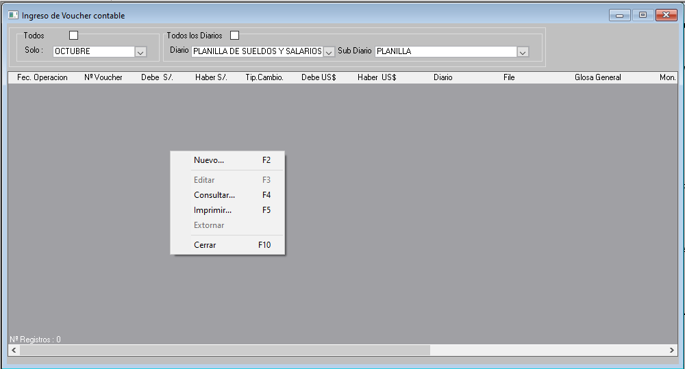

### Elementos de la Bandeja:
1. **Panel de Filtros Superiores:**
   * Casilla `Todos` / Menú desplegable `Solo:` (Mes de proceso, ej. OCTUBRE).
   * Casilla `Todos los Diarios` / Menú desplegable `Diario` (ej. *PLANILLA DE SUELDOS Y SALARIOS*, *REGISTRO DE VENTAS*, *REGISTRO DE COMPRAS*).
   * Menú desplegable `Sub Diario` / `File`.
2. **Barra de Herramientas y Acciones Rápidas:**
   * La bandeja cuenta con barra de herramientas superior para las acciones estándar.
   * Adicionalmente, al hacer **clic derecho** sobre cualquier fila o zona de la grilla, se dispone de las funciones operativas y sus respectivos atajos de teclado:
     * **`Nuevo...` [F2]**: Abre el formulario en blanco para digitar un nuevo comprobante.
     * **`Editar` [F3]**: Abre el voucher seleccionado para modificar cuentas, glosas o importes.
     * **`Consultar...` [F4]**: Abre el voucher en modo de solo lectura para auditoría.
     * **`Imprimir...` [F5]**: Emite el voucher contable para impresión o archivo digital.
     * **`Extornar`**: Genera un asiento de reversión contable para el voucher marcado.
     * **`Cerrar` [F10]**: Cierra la ventana activa.
3. **Columnas de la Grilla de Vouchers:**
   * `Fec. Operación`, `Nº Voucher`, `Debe S/.`, `Haber S/.`, `Tip.Cambio.`, `Debe US$`, `Haber US$`, `Diario`, `File`, `Glosa General`, `Mon.`, `Nº Items`, `Estado` (ej. *Cuadrado*).

---

## **3. Formulario de Alta de Comprobante: `Ingreso de Voucher contable (Nuevo)`**

Al presionar **`F2`** o hacer clic en **`Nuevo...`**, se despliega el formulario principal de captura:

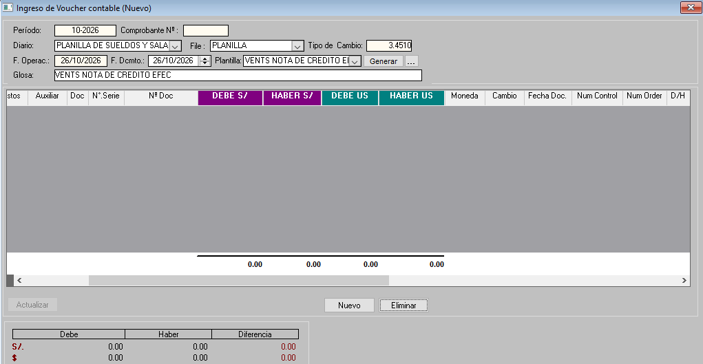

### Campos de Cabecera:
* **Período:** Código de mes y año contable (ej. `10-2026`).
* **Comprobante Nº:** Número correlativo asignado al voucher (generado automáticamente al guardar).
* **Diario / File:** Tipo de operación contable y subclasificación.
* **Tipo de Cambio:** Valor numérico del tipo de cambio aplicado a la operación.
* **F. Operac. / F. Dcmto.:** Fechas de registro y de emisión del documento fuente.
* **Plantilla:** Selector de asientos preconfigurados con botones `Generar` y `[...]`.
* **Glosa:** Explicación global de la operación contable.
* **Botonera de Control (Superior Izquierda):**
  * Icono **Disquete**: Guarda y confirma el voucher en la base de datos.
  * Icono **Impresora**: Emite el voucher contable.
  * Icono **Puerta**: Sale del formulario cancelando cambios no guardados.

---

## **4. Método 1: Generación Asistida mediante Plantillas**

Para registrar operaciones repetitivas (compras habituales, provisiones de servicios, notas de crédito, recibos por honorarios):

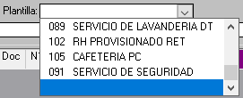

1. En el campo **`Plantilla`**, despliegue la lista y seleccione el modelo contable correspondiente (ej. *012 VENTS NOTA DE CREDITO EFEC*, *089 SERVICIO DE LAVANDERIA DT*, *102 RH PROVISIONADO RET*, *105 CAFETERIA PC*, etc.).
2. Haga clic en el botón **`Generar`**.
3. El sistema abrirá la ventana modal de parámetros de la plantilla:

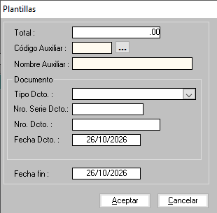

4. Complete la información requerida:
   * **Total:** Digite el monto bruto de la transacción.
   * **Código Auxiliar:** Digite el código o presione el botón `[...]` para invocar el buscador de auxiliares:

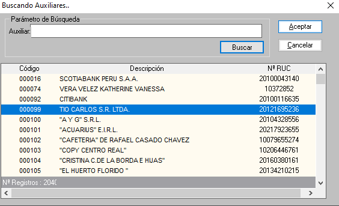

   * **Documento:** Seleccione el `Tipo Dcto.` e ingrese el `Nro. Serie Dcto.` y `Nro. Dcto.`.
   * **Fecha Dcto. / Fecha fin:** Fechas de emisión y vigencia.
5. Presione **`Aceptar`**. El ERP distribuirá de inmediato el importe entre las cuentas contables de gasto/ingreso, IGV y cuenta por pagar/cobrar según los porcentajes definidos, cuadrando el asiento de forma automática.

---

## **5. Método 2: Digitación Manual Línea por Línea**

Para registrar asientos manuales o específicos:

1. En la parte inferior de la grilla del voucher, haga clic en el botón **`Nuevo`**.
2. Se abrirá la ventana modal de detalle de línea:

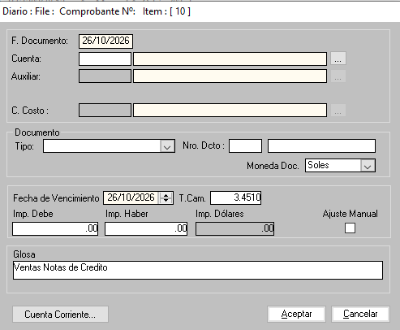

### Campos del Item de Asiento:
* **F. Documento:** Fecha del comprobante de soporte.
* **Cuenta:** Código contable. Puede abrir el catálogo mediante el botón `[...]` (`Buscador de Cuentas`):

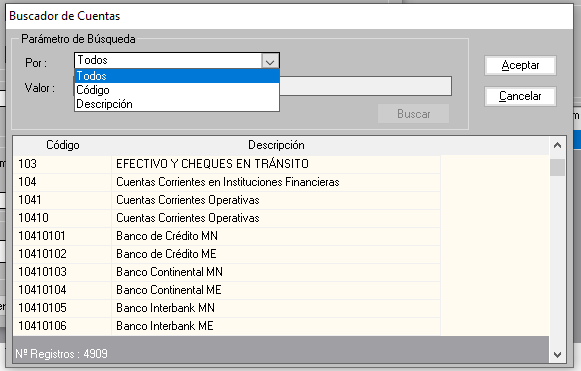

> [!CAUTION]
> **Validación de Imputabilidad:**  
> Si intenta ingresar una cuenta de balance o cuenta de cabecera/integradora, el sistema bloqueará la acción con el siguiente aviso:  
> 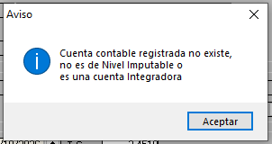  
> *«Cuenta contable registrada no existe, no es de Nivel Imputable o es una cuenta Integradora»*.  
> **Solución:** Seleccione siempre una subdivisionaria de último nivel marcada como imputable.

* **Auxiliar:** RUC o documento de identidad del tercero asociado a la línea (si la cuenta lo exige).
* **C. Costo:** Centro de costos asignado al gasto.
* **Documento:** Tipo de comprobante, serie, número y moneda (Soles o Dólares).
* **Vencimiento e Importes:** Ingrese `Fecha de Vencimiento`, `T.Cam.` e importe en **`Imp. Debe`** o **`Imp. Haber`**. El sistema calculará el equivalente en dólares (`Imp. Dólares`).
* **Ajuste Manual:** Casilla para fijar tipos de cambio excepcionales.
* **Glosa:** Descripción particular de la partida.

---

## **6. Cruce con Cuentas Corrientes (Cancelaciones y Amortizaciones)**

Al registrar cuentas por cobrar o por pagar (ej. facturas pendientes, liquidaciones, letras):

1. En la ventana del Item, haga clic en el botón **`Cuenta Corriente...`**.
2. El sistema abrirá la ventana de amortización:

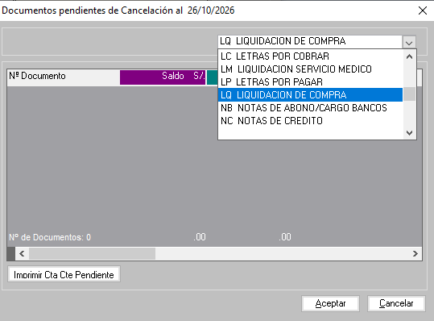

3. Filtre por tipo de documento:
   * `LQ` LIQUIDACION DE COMPRA
   * `LC` LETRAS POR COBRAR
   * `LM` LIQUIDACION SERVICIO MEDICO
   * `LP` LETRAS POR PAGAR
   * `NB` NOTAS DE ABONO/CARGO BANCOS
   * `NC` NOTAS DE CREDITO
4. Seleccione el documento pendiente y presione **`Aceptar`**. El saldo se vinculará directamente a la línea contable, actualizando la cartera del auxiliar.

---

## **7. Cuadre Final y Confirmación del Voucher**

Una vez ingresadas las partidas, revise la grilla y el panel de control inferior:

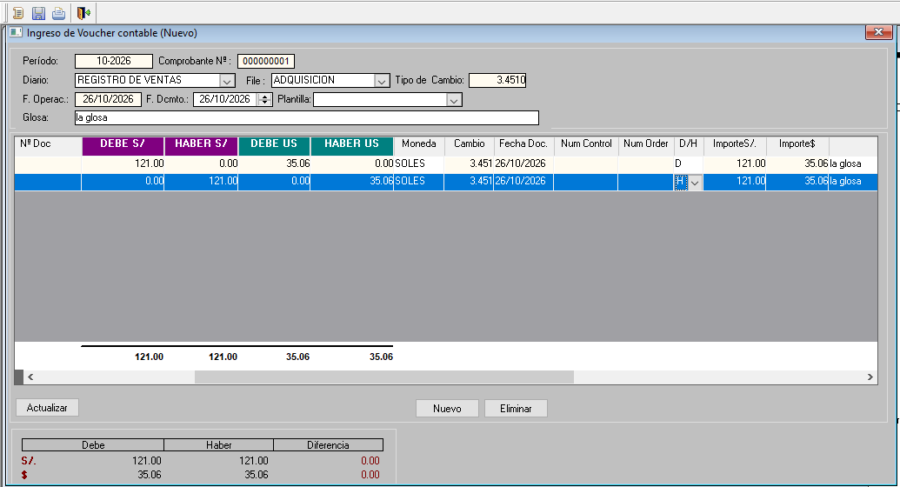

* **Cuadro de Cuadre:**
  * Debe S/. = Haber S/. ➔ `Diferencia: 0.00`
  * Debe US$ = Haber US$ ➔ `Diferencia: 0.00`
* Para finalizar, haga clic en el icono del **Disquete** en la barra superior.
* El asiento se guardará con su número definitivo y aparecerá en la bandeja general con estado **`Cuadrado`**:

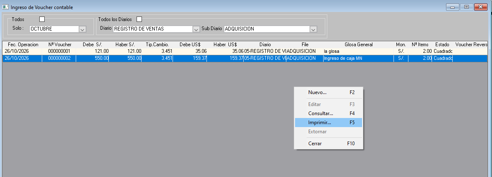

---

## **8. Modificación y Extorno de Vouchers**

1. Para corregir asientos existentes, ingrese a `Contabilidad › Transacciones › Modif. de Comprobantes`.
2. Filtre por el mes y diario donde se ubica el voucher.
3. Haga clic derecho sobre el registro:
   * Para corregir una cuenta o glosa: seleccione **`Editar` [F3]**. El voucher se cargará permitiendo realizar ajustes siempre que se mantenga el cuadre final.
   * Para anular contablemente el efecto de un voucher: seleccione **`Extornar`**. El sistema generará el asiento de reverso correspondiente manteniendo intacta la auditoría histórica.

---

# **DOC-07 · Matriz RACI**

* **R (Responsible):** Ejecuta la actividad.
* **A (Accountable):** Aprueba y responde por el resultado final.
* **C (Consulted):** Se le consulta información técnica o soporte.
* **I (Informed):** Se le notifica el resultado.

|**Actividad**|**Asistente Contable**|**Contador General**|**Gerente Financiero**|**Auditor Interno**|
| :--- | :---: | :---: | :---: | :---: |
|Configuración y mantenimiento de Diarios y Plantillas|C|R / A|I|I|
|Digitación y registro de vouchers diarios (Ruta Manual y Plantillas)|R|A|I|I|
|Cruce de comprobantes con Cuentas Corrientes pendientes|R|A|I|I|
|Revisión, auditoría y modificación de vouchers en `Modif. de Comprobantes`|C|R / A|I|I|
|Autorización y ejecución de Extornos contables|I|R / A|I|C|
|Generación periódica de Asientos de Gastos y Diferencia de Cambio|I|R / A|I|I|

---

# **DOC-08 · Roles y permisos en el sistema**

* **V:** Ver / Consultar (Solo Lectura)
* **E:** Ejecutar / Crear / Modificar
* **EX:** Extornar / Reversar
* **X:** Sin acceso

|**Opción de Menú / Función**|**Asistente Contable**|**Contador General**|**Auditor / Consulta**|
| :--- | :---: | :---: | :---: |
|`Contabilidad › Maestros › Tipos de Diarios`|V|V, E|V|
|`Contabilidad › Maestros › Plantilla Comprobantes`|V|V, E|V|
|`Contabilidad › Transacciones › Ingreso de Comprobantes` (Nuevo)|V, E|V, E|V|
|`Contabilidad › Transacciones › Modif. de Comprobantes` (Editar / Extornar)|V|V, E, EX|V|
|Modal `Cuenta Corriente...` (Amortización de pendientes)|V, E|V, E|V|
|`Contabilidad › Procesos › Asiento Cta. de Gastos`|X|E|V|
|`Contabilidad › Procesos › Ajuste x Diferencia › Generación de Asiento`|X|E|V|

---

# **DOC-09 · Integraciones operativas del submódulo**

|**ID**|**Origen**|**Destino**|**Mecanismo de Integración**|**Impacto en la Base de Datos**|
| :--- | :--- | :--- | :--- | :--- |
|**INT-02-01**|Plan de Cuentas Contables|Ingreso de Comprobantes|Validación en línea al digitar código contable.|Verifica existencia de cuenta y restringe el uso de cuentas integradoras (solo permite cuentas imputables).|
|**INT-02-02**|Mantenimiento de Auxiliares|Líneas de Comprobante / Plantillas|Buscador modal `Buscando Auxiliares..` por RUC o Razón Social.|Asocia el documento de identidad del proveedor, cliente o empleado a la partida contable.|
|**INT-02-03**|Cuentas Corrientes (Cartera Pendiente)|Item de Comprobante (`Cuenta Corriente...`)|Selector de documentos pendientes por auxiliar (`LQ`, `LC`, `LM`, `LP`, etc.).|Actualiza saldos de documentos en cuentas por cobrar/pagar tras la confirmación del voucher.|
|**INT-02-04**|Plantillas de Comprobantes|Voucher Contable (`Generar...`)|Cálculo algorítmico porcentual sobre el importe total ingresado.|Puebla automáticamente múltiples filas en la grilla con cuentas, porcentajes de impuestos (IGV) y contrapartidas.|
|**INT-02-05**|Vouchers Cuadrados|Libros Contables y Estados Financieros|Almacenamiento directo en tablas transaccionales del Diario.|Alimenta el Libro Diario, Libro Mayor, Balance de Comprobación y Cierre de Periodo.|

---

# **DOC-10 · Catálogo de reportes asociados**

El submódulo de comprobantes cuenta con emisión directa desde la grilla y se enlaza con el submódulo de Reportes:

|**Reporte**|**Ruta en el ERP**|**Parámetros de Entrada**|**Uso Principal**|
| :--- | :--- | :--- | :--- |
|**Impresión de Voucher Contable**|Grilla de comprobantes ➔ Menú contextual `Imprimir...` [F5]|Voucher seleccionado.|Comprobante impreso individual con detalle de cuentas, Debe, Haber y firmas de control.|
|**Voucher por Diario**|`Contabilidad › Reportes › Voucher por Diario`|Mes, Rango de Diarios, Rango de Vouchers.|Listado ordenado de comprobantes registrados en un diario específico.|
|**Libro Diario General**|`Contabilidad › Reportes › Libro Diario General`|Período, moneda, orden cronológico.|Libro oficial para presentación tributaria y auditoría contable.|
|**Lista de Cpbtes. Descuadrados**|`Contabilidad › Transacciones › Lista Cpbtes. Descuadrados`|Mes y diario.|Reporte de control preventivo para ubicar vouchers con diferencias antes del cierre.|

---

# **DOC-11 · Casos de prueba operativos**

|**ID**|**Funcionalidad**|**Escenario de Prueba**|**Pasos a Ejecutar**|**Resultado Esperado**|**Resultado en Sistema**|**Estado**|
| :- | :- | :- | :- | :- | :- | :-: |
|**CP-02-01**|Validación Cuenta Integradora|Intentar registrar una línea usando una cuenta de nivel superior (ej. cuenta a 3 o 4 dígitos).|1. Abrir voucher nuevo. 2. Click en Nuevo item. 3. Digitar cuenta integradora (ej. 104).|El sistema bloquea la cuenta y muestra modal: *«no es de Nivel Imputable o es una cuenta Integradora»*.|Bloqueo efectivo comprobado en pantalla.|**Conforme**|
|**CP-02-02**|Generación por Plantilla|Generar voucher automático seleccionando plantilla de compras/ventas.|1. Seleccionar plantilla. 2. Click en `Generar`. 3. Ingresar Total y Auxiliar. 4. Click Aceptar.|Se generan automáticamente las líneas con cálculo de base e impuestos cuadrados.|Cálculo y distribución automática comprobada.|**Conforme**|
|**CP-02-03**|Cruce con Cuenta Corriente|Amortizar una cuenta por pagar vinculando documento pendiente.|1. En línea de cuenta 42, click `Cuenta Corriente...`. 2. Filtrar tipo de doc. 3. Seleccionar documento. 4. Aceptar.|El sistema extrae el número de documento y aplica la amortización al saldo.|Ventana operativa con listado de pendientes comprobada.|**Conforme**|
|**CP-02-04**|Control de Cuadre Bimonetario|Intentar guardar un voucher con diferencia diferente de cero.|1. Digitar línea en Debe sin contrapartida. 2. Observar cuadro inferior. 3. Intentar guardar.|El cuadro muestra `Diferencia` en rojo y el sistema impide grabar el comprobante descuadrado.|Cuadro de cuadre en soles y dólares validado en grilla.|**Conforme**|
|**CP-02-05**|Extorno de Comprobante|Reversar voucher emitido por error mediante función directa.|1. Ir a `Modif. de Comprobantes`. 2. Clic derecho en voucher. 3. Seleccionar `Extornar`.|El sistema genera un nuevo asiento con las posiciones Debe/Haber invertidas.|Función disponible en menú contextual de la grilla.|**Conforme**|

---
*CLINICA LA LUZ SAC · Módulo de Contabilidad · Sistema SAMI / ERP Dialyma*

# **DOC-10 · Catálogo de reportes asociados**

El submódulo de comprobantes cuenta con emisión directa desde la grilla y se enlaza con el submódulo de Reportes:

|**Reporte**|**Ruta en el ERP**|**Parámetros de Entrada**|**Uso Principal**|
| :--- | :--- | :--- | :--- |
|**Impresión de Voucher Contable**|Grilla de comprobantes ➔ Menú contextual `Imprimir...` [F5]|Voucher seleccionado.|Comprobante impreso individual con detalle de cuentas, Debe, Haber y firmas de control.|
|**Voucher por Diario**|`Contabilidad › Reportes › Voucher por Diario`|Mes, Rango de Diarios, Rango de Vouchers.|Listado ordenado de comprobantes registrados en un diario específico.|
|**Libro Diario General**|`Contabilidad › Reportes › Libro Diario General`|Período, moneda, orden cronológico.|Libro oficial para presentación tributaria y auditoría contable.|
|**Lista de Cpbtes. Descuadrados**|`Contabilidad › Transacciones › Lista Cpbtes. Descuadrados`|Mes y diario.|Reporte de control preventivo para ubicar vouchers con diferencias antes del cierre.|

---

# **DOC-11 · Casos de prueba operativos**

|**ID**|**Funcionalidad**|**Escenario de Prueba**|**Pasos a Ejecutar**|**Resultado Esperado**|**Resultado en Sistema**|**Estado**|
| :- | :- | :- | :- | :- | :- | :-: |
|**CP-02-01**|Validación Cuenta Integradora|Intentar registrar una línea usando una cuenta de nivel superior (ej. cuenta a 3 o 4 dígitos).|1. Abrir voucher nuevo. 2. Click en Nuevo item. 3. Digitar cuenta integradora (ej. 104).|El sistema bloquea la cuenta y muestra modal: *«no es de Nivel Imputable o es una cuenta Integradora»*.|Bloqueo efectivo comprobado en pantalla.|**Conforme**|
|**CP-02-02**|Generación por Plantilla|Generar voucher automático seleccionando plantilla de compras/ventas.|1. Seleccionar plantilla. 2. Click en `Generar`. 3. Ingresar Total y Auxiliar. 4. Click Aceptar.|Se generan automáticamente las líneas con cálculo de base e impuestos cuadrados.|Cálculo y distribución automática comprobada.|**Conforme**|
|**CP-02-03**|Cruce con Cuenta Corriente|Amortizar una cuenta por pagar vinculando documento pendiente.|1. En línea de cuenta 42, click `Cuenta Corriente...`. 2. Filtrar tipo de doc. 3. Seleccionar documento. 4. Aceptar.|El sistema extrae el número de documento y aplica la amortización al saldo.|Ventana operativa con listado de pendientes comprobada.|**Conforme**|
|**CP-02-04**|Control de Cuadre Bimonetario|Intentar guardar un voucher con diferencia diferente de cero.|1. Digitar línea en Debe sin contrapartida. 2. Observar cuadro inferior. 3. Intentar guardar.|El cuadro muestra `Diferencia` en rojo y el sistema impide grabar el comprobante descuadrado.|Cuadro de cuadre en soles y dólares validado en grilla.|**Conforme**|
|**CP-02-05**|Extorno de Comprobante|Reversar voucher emitido por error mediante función directa.|1. Ir a `Modif. de Comprobantes`. 2. Clic derecho en voucher. 3. Seleccionar `Extornar`.|El sistema genera un nuevo asiento con las posiciones Debe/Haber invertidas.|Función disponible en menú contextual de la grilla.|**Conforme**|

---
*CLINICA LA LUZ SAC · Módulo de Contabilidad · Sistema SAMI / ERP Dialyma*

