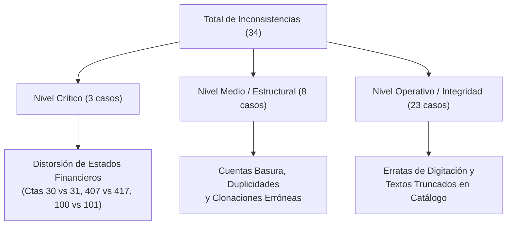

# Informe Gerencial de Auditoría: Inconsistencias, Errores de Parametrización y Plan de Saneamiento del Plan Contable

**Destinatario**: Dirección Financiera / Gerencia de Contabilidad  
**Alcance**: Auditoría Integral del Maestro de Cuentas del Sistema ERP (Elementos 0 al 9)  
**Objetivo**: Identificar con precisión de código contable todas las inconsistencias estructurales, duplicidades, cuentas de prueba y desvíos normativos respecto al Plan Contable General Empresarial (PCGE) y las NIIF, estableciendo el plan de acción técnico para su corrección.

---

## 1. Resumen Ejecutivo y Matriz de Severidad

Se ha detectado un total de **34 inconsistencias** parametrizadas en la base de datos del ERP, clasificadas según su nivel de impacto contable y de auditoría:

| Nivel de Riesgo | Cantidad | Impacto Principal | Acción Inmediata |
| :--- | :---: | :--- | :--- |
| **CRÍTICO** | 3 | Distorsión de rubros en el Balance General y reclasificaciones en auditoría externa. | Corrección inmediata en base de datos contable. |
| **MEDIO** | 8 | Registros residuales de pruebas, cuentas clonadas con nombre falso y duplicidad de imputación. | Inactivación / Depuración de códigos. |
| **BAJO** | 23 | Erratas ortográficas, palabras truncadas y errores tipográficos en el catálogo maestro. | Corrección de textos en descripciones. |

---

## 2. Inconsistencias de Nivel Crítico (Alto Impacto Financiero)

### 2.1. Inversión Inmobiliaria vs Inversión Mobiliaria (Código 30 vs Código 31)

> [!CAUTION] **Error Crítico de Homonimia y Clasificación Normativa**:
> - **Código en el Sistema**: `30`  
> - **Nombre Actual en el ERP**: `30 INVERSIONES INMOBILIARIAS`  
> - **Conflicto con**: Cuenta `31 INVERSIONES INMOBILIARIAS`  
> - **Elemento**: Elemento 3 (Activo Inmovilizado)

* **Diagnóstico Técnico**:
  Al analizar las subcuentas que dependen directamente de la cuenta `30`, se constata que todas corresponden a títulos valores e instrumentos financieros de capital:
  * `301 Inversiones a Ser Mantenidas Hasta el Vencimiento` (bonos del Estado, sistema financiero y empresas).
  * `302 Instrumentos Finan Repres de Derecho Patrimonial` (acciones comunes, preferentes, fondos mutuos, consorcios).
  * `308 Inversiones Mobiliarias - Acuerdo de Compra`.
  
  Por su parte, la cuenta `31` agrupa legítimamente las inversiones en terrenos (`311`) y edificaciones (`312`) para renta.  
  Por tanto, la cuenta `30` corresponde normativamente a **`30 INVERSIONES MOBILIARIAS`** (NIIF 9 / NIC 39). Su denominación actual como "Inmobiliarias" duplica el nombre de la cuenta `31` y genera confusión operativa y reportes financieros viciados.
* **Acción Correctiva Requerida**: Renombrar la cabecera del código `30` en el ERP a **`30 INVERSIONES MOBILIARIAS`**.

---

### 2.2. Duplicidad Funcional de Retenciones Previsionales (Código 407 vs Código 417)

> [!WARNING] **Coexistencia de Dos Cuentas para el Mismo Pasivo Previsional**:
> - **Código 1**: `407` -> `4070` -> `40700 Administradoras de Fondos de Pensiones` (en Tributos y Aportes).
> - **Código 2**: `417` -> `4170` -> `41700 ADMINISTRADORA DE FONDOS DE PENSIONES` (en Remuneraciones por Pagar).
> - **Elemento**: Elemento 4 (Pasivo)

* **Diagnóstico Técnico**:
  Ambas cuentas registran la retención del aporte obligatorio que la empresa descuenta al trabajador para transferirlo a las AFP (Integra, Prima, Profuturo, Habitat). De acuerdo con la dinámica oficial del PCGE, las retenciones tributarias y de seguridad social deben concentrarse bajo la cuenta `407`.
* **Impacto**: Riesgo de dispersión contable al pagar planillas, descuadre de liquidaciones en el PDT Planilla Electrónica (PLAME) y saldos flotantes entre dos pasivos distintos.
* **Acción Correctiva Requerida**: Trasladar todo el saldo histórico de la cuenta `41700` hacia la `40700` y bloquear la cuenta `417` para futuras contabilizaciones.

---

### 2.3. Duplicidad en el Control de Efectivo en Caja (Código 100 vs Código 101)

> [!WARNING] **Coexistencia de Código No Estándar con Código PCGE**:
> - **Código 1**: `100` -> `1001` -> `10011 CAJA` (Código personalizado no estándar).
> - **Código 2**: `101` -> `1010` -> `10100 Caja` (Código oficial del PCGE).
> - **Elemento**: Elemento 1 (Activo Disponible)

* **Diagnóstico Técnico**:
  En la parametrización inicial se creó una rama artificial `100` que convive en paralelo con la cuenta estándar `101`.
* **Acción Correctiva Requerida**: Unificar el registro del efectivo en la cuenta oficial `10100` e inactivar la rama `100`.

---

## 3. Cuentas de Prueba, Nodos Basura y Textos Pendientes de Configuración

En tres cuentas estratégicas del plan existen registros residuales generados durante la etapa de pruebas o pendientes de parametrizar:

| Código Exacto | Nombre Actual en el ERP | Cuenta Padre | Elemento | Diagnóstico del Error | Acción Requerida |
| :---: | :--- | :--- | :---: | :--- | :--- |
| **`12111`** | `12111 5555` | `1211 Facturas No Emitidas` | 1 | Registro basura numérico (`5555`) creado como hijo de `1211` y que a su vez contiene una sub-hija `12110`. Rompe la jerarquía normal. | **Eliminar / Inactivar**: Reclasificar los movimientos que pudiera tener hacia la `12110`. |
| **`46999`** | `46999 CAMBIAR DESCRIPCION` | `4699 Otras Cuentas por Pagar` | 4 | Subdivisionaria en la que se dejó como nombre provisional el recordatorio del sistema. | **Corregir / Asignar**: Renombrar con el pasivo específico que deba controlar o bloquear si no se usa. |
| **`7042` / `70420`** | `7042 CAMBIAR LA DESCRIPCION` / `70420 CAMBIAR DESCRIPCION` | `704 Prestación de Servicios` | 7 | Divisionaria y subdivisionaria de ingresos dejada con el texto por defecto de instalación. | **Corregir / Asignar**: Renombrar con la línea de servicio real que facture la empresa o inactivar. |

---

## 4. Cuentas Duplicadas y Cuentas de Migración Residual

### 4.1. Duplicidad en Intereses por Fraccionamiento Tributario (Código 3733 vs Código 3739)
* **Códigos Afectados**:
  * `3733` -> `37330 INTERESES DE FRACCIONAMIENTO TRIBUTARIO`
  * `3739` -> `37390 INTERESES POR FRACCIONAMIENTO TRIBUTARIO`
* **Cuenta Padre**: `373 Intereses Diferidos` (Elemento 3 - Activos Diferidos)
* **Diagnóstico**: Ambas cuentas fueron creadas con el mismo propósito económico (registrar los intereses no devengados derivados de convenios de fraccionamiento con SUNAT bajo el Art. 36 del Código Tributario).
* **Acción Requerida**: Consolidar los importes en la cuenta `37330` e inactivar la `37390`.

### 4.2. Cuentas Residuales de Migración / Carga Inicial
* **Código `18999`**: `18999 18999 APERTURA` bajo `189 Otras Cuentas Contratadas por Anticipado` (Elemento 1).
* **Código `25220`**: `25220 25220 APERTURA` bajo `252 Suministros` (Elemento 2).
* **Diagnóstico**: Cuentas técnicas transitorias utilizadas como contrapartida para el balance de apertura durante la migración al ERP. No deben quedar abiertas para la operación corriente.
* **Acción Requerida**: Cerrar con saldo cero y aplicar bloqueo de digitación en el sistema.

---

## 5. Subdivisionarias con Nombre Erróneo por Falla de Clonación

Al momento de configurar el árbol contable, el administrador clonó las ramas superiores pero omitió modificar la descripción de la última subdivisionaria analítica:

| Código Exacto | Cuenta Padre | Elemento | Nombre Erróneo Configurado en ERP | Denominación Correcta que Debe Asignarse |
| :---: | :--- | :---: | :--- | :--- |
| **`07120`** | `0712 Compromiso Sobre Inv Disponibles Para la Vta` | 0 | `07120 Compromiso Sobre Inv Mantenidas Para Negociación` | **`07120 Compromiso Sobre Inv Disponibles Para la Venta`** *(Heredó el texto de la cuenta contigua 07110)*. |
| **`11242`** | `1124 Otros Títulos Representativos de Deuda` | 1 | `11242 Otros Títulos Represent de Deuda - Costo` | **`11242 Otros Títulos Represent de Deuda - Valor Razonable`** *(Idéntica a la 11241 que ya es Costo)*. |
| **`77710`** | `7771 Ganancia x Medición de Inv Mant Para Nego Val Raz` | 7 | `77710 Ganancia x Medición de Act y Pas Finan Valor Razon` | **`77710 Ganancia x Medición de Inv Mant Para Nego Val Raz`** *(Heredó el texto de la cuenta padre 777)*. |

---

## 6. Saltos Numéricos y Rupturas de Jerarquía

Se han detectado vacíos en la correlatividad de cuentas que afectan la consistencia del árbol:

1. **Omisión de Sucursales en Dividendos por Cobrar (Código `1733`)**:
   * En `1733 Dividendos` (Elemento 1): existen `17331 Matriz`, `17332 Subsidiarias`, `17333 Asociadas`, y salta directamente a `17335 Otros`.
   * **Inconsistencia**: Se omitió el código **`17334 Sucursales`**, el cual sí existe de forma homogénea en las cuentas paralelas `17314` (Intereses) y `17324` (Cánones y Regalías).
2. **Omisión de Valor Razonable en Depreciación de Activos Biológicos Para la Venta (Código `278`)**:
   * En `2781 Dep Acum - Activos Biológicos en Poduc Para Venta`: sólo existe `27812 Costo` (omite la subdivisionaria `27811 Valor Razonable`).
   * En `2782 Dep Acum - Activos Biológicos en Desarr Para Venta`: sólo existe `27822 Costo` (omite la `27821 Valor Razonable`).
3. **Salto en Arrendamiento Financiero de Transporte (Código `3224`)**:
   * En `3224 Equipo de Transporte Arrendamiento Financiero` (Elemento 3): existe `32241 Equipo de Transporte - Motorizado` y salta directamente a `32243 CAMIONETAS`, omitiendo el código **`32242`**.

---

## 7. Cuentas Críticas por Amplitud de Desglose Analítico

Estas cuentas concentran el mayor volumen de subdivisionarias analíticas del plan contable y requieren especial atención en los procesos de cierre y conciliación:

| Rango de Cuentas | Denominación del Rubro | Elemento | Niveles de Desglose | Observación de Control Interno |
| :---: | :--- | :---: | :---: | :--- |
| **`27111` a `27952`** | Activos No Corrientes Mantenidos para la Venta | 2 | 5 niveles | Despliega activos, depreciaciones y deterioros bajo NIIF 5. Requiere inventario periódico de bienes dados de baja. |
| **`36110` a `36620`** | Desvalorización de Activos Inmovilizados | 3 | 5 niveles | Correctoras por deterioro de activos fijos, intangibles y biológicos (NIC 36). |
| **`43111` a `43415`** | Cuentas por Pagar Comerciales - Relacionadas | 4 | 5 niveles | Clasificación obligatoria entre Matriz, Subsidiarias, Asociadas y Sucursales para Precios de Transferencia. |
| **`45110` a `45600`** | Obligaciones Financieras y Contratos de Leasing | 4 | 5 niveles | Incluye desglose por entidades bancarias específicas (Scotiabank, BBVA, GNB, BanBif). |
| **`47110` a `47915`** | Cuentas por Pagar Diversas - Relacionadas | 4 | 5 niveles | Préstamos, dividendos, pasivos por activo fijo y regalías con empresas vinculadas. |
| **`60911` a `60945`** | Costos Vinculados con las Compras (Fletes/Aduanas) | 6 | 5 niveles | Asignación analítica de fletes, seguros y comisiones a existencias (NIC 2). |
| **`68111` a `68690`** | Valuación, Deterioro de Activos y Provisiones | 6 | 5 niveles | Concentra las estimaciones de depreciación, cobranza dudosa, litigios y medio ambiente. |
| **`70111` a `70962`** | Ventas Netas y Devoluciones por Tipo de Bien | 7 | 5 niveles | Cruce obligatorio entre despachos a Terceros y a Empresas Relacionadas. |

---

## 8. Catálogo Exhaustivo de Erratas Tipográficas y Textos Truncados

Se identificaron **23 códigos contables** cuyas descripciones contienen faltas de ortografía o caracteres incompletos que desmerecen la calidad de los reportes oficiales:

| Código Exacto | Elemento | Texto Actual en el Sistema ERP | Corrección Ortográfica Recomendada | Diagnóstico del Error |
| :---: | :---: | :--- | :--- | :--- |
| **`0322`** | 0 | `Inmuebles Maquinara y Equipo Dados de Baja` | `Inmuebles Maquinaria y Equipo Dados de Baja` | Typo: "Maquinara" por "Maquinaria". |
| **`071`** | 0 | `Compromisos Sobre Instumentos Financieros Primario` | `Compromisos Sobre Instrumentos Financieros Primarios` | Typo: "Instumentos" por "Instrumentos". |
| **`0721`** | 0 | `Compromisos Sebre Contratos a Futuro` | `Compromisos Sobre Contratos a Futuro` | Typo: "Sebre" por "Sobre". |
| **`1331`** | 1 | `Relaciondas Letras por Cobrar en Cartera` | `Relacionadas Letras por Cobrar en Cartera` | Typo: "Relaciondas" por "Relacionadas". |
| **`1333`** | 1 | `Realcionadas Letras por Cobrar en Descuento` | `Relacionadas Letras por Cobrar en Descuento` | Typo: "Realcionadas" por "Relacionadas". |
| **`1671`** | 1 | `PAGOS A CUENTA DEL IMPUESTO ALA RENTA` | `PAGOS A CUENTA DEL IMPUESTO A LA RENTA` | Error de espaciado: "ALA" por "A LA". |
| **`1753`** | 1 | `Relacionadas Venta de Inmuebles, Maquinaria y Equi` | `Relacionadas Venta de Inmuebles, Maquinaria y Equipo` | Texto truncado por límite de caracteres ("Equi"). |
| **`1958`** | 1 | `Estimación Relacinadas Otras Cuentas x Cobrar Div` | `Estimación Relacionadas Otras Cuentas x Cobrar Div` | Typo: "Relacinadas" por "Relacionadas". |
| **`23322`** | 2 | `Prod de Origen Vegetal en Proceso a Valor Razonabl` | `Prod de Origen Vegetal en Proceso a Valor Razonable` | Texto truncado ("Razonabl"). |
| **`255`** | 2 | `Materiales para Mant. De Equupos medicos` | `Materiales para Mant. De Equipos Médicos` | Typo: "Equupos" por "Equipos". |
| **`27123`** | 2 | `Inversiones Edificaciones Para Venta - Revelación` | `Inversiones Edificaciones Para Venta - Revaluación` | Error conceptual: "Revelación" en lugar de "Revaluación". |
| **`2781`** | 2 | `Dep Acum - Activos Biológicos en Poduc Para Venta` | `Dep Acum - Activos Biológicos en Producción Para Venta` | Typo: "Poduc" por "Producción". |
| **`27932`** | 2 | `Desval Acum Edificaiones Para Venta` | `Desval Acum Edificaciones Para Venta` | Typo: "Edificaiones" por "Edificaciones". |
| **`2923`** | 2 | `Desvalorización Prod Agropec y Piscolas Terminados` | `Desvalorización Prod Agropec y Piscícolas Terminados` | Typo: "Piscolas" por "Piscícolas". |
| **`293`** | 2 | `293 Desvalorizació Sub Productos, Desechos y Desperdic` | `293 Desvalorización Subproductos, Desechos y Desperdicios` | Typo: "Desvalorizació" y "Desperdic". |
| **`4153`** | 4 | `Pensiones y Jubilciones por Pagar` | `Pensiones y Jubilaciones por Pagar` | Typo: "Jubilciones" por "Jubilaciones". |
| **`4776`** | 4 | `Pasivo por Compra Acitvos Biológicos Relacionadas` | `Pasivo por Compra Activos Biológicos Relacionadas` | Typo: "Acitvos" por "Activos". |
| **`483`** | 4 | `Povisión Para Reestructuraciones` | `Provisión Para Reestructuraciones` | Typo: "Povisión" por "Provisión". |
| **`6552`** | 6 | `Operaciones Dicontinuadas - Abandono de Activos` | `Operaciones Discontinuadas - Abandono de Activos` | Typo: "Dicontinuadas" por "Discontinuadas". |
| **`68432`** | 6 | `Desvalorización Inst Finan Repres de Dercho Patrim` | `Desvalorización Inst Finan Repres de Derecho Patrimonial` | Typo: "Dercho" por "Derecho". |
| **`68541`** | 6 | `Desval Activos Biológicos en Prod Origen Aninal` | `Desval Activos Biológicos en Prod Origen Animal` | Typo: "Aninal" por "Animal". |
| **`70935`** | 7 | `Dev Vtas Existencias Servicios Terminaods Terceros` | `Dev Vtas Existencias Servicios Terminados Terceros` | Typo: "Terminaods" por "Terminados". |
| **`72541`** | 7 | `Prod Costo Fianan Act Biológ de Origen Animal` | `Prod Costo Finan Act Biológ de Origen Animal` | Typo: "Fianan" por "Finan / Financiación". |

---

## 9. Plan de Acción Recomendado para la Gerencia

Para subsanar estas inconsistencias sin alterar la operatividad diaria de la empresa, se sugiere seguir este cronograma de saneamiento:

1. **Fase 1 - Inmediata (Sistemas / Base de Datos)**:
   * Modificar la descripción del código `30` a `30 INVERSIONES MOBILIARIAS`.
   * Corregir las tres subdivisionarias clonadas (`07120`, `11242`, `77710`).
   * Aplicar script de actualización para corregir las 23 erratas ortográficas del catálogo.
2. **Fase 2 - Cierre Mensual (Operativa Contable)**:
   * Realizar asiento de reclasificación de la cuenta `41700` hacia la `40700` (AFP).
   * Unificar los saldos de la cuenta `10011` hacia la `10100` (Caja).
   * Trasladar el saldo de la cuenta `37390` a la `37330` (Fraccionamientos).
3. **Fase 3 - Depuración y Seguridad (Bloqueo de Registros)**:
   * Inactivar y bloquear el acceso a las cuentas basura (`12111`, `46999`, `70420`).
   * Bloquear permanentemente las cuentas de apertura `18999` y `25220` para evitar nuevos registros manuales.

---

## 7. Cuentas Críticas por Amplitud de Desglose Analítico

Estas cuentas concentran el mayor volumen de subdivisionarias analíticas del plan contable y requieren especial atención en los procesos de cierre y conciliación:

| Rango de Cuentas | Denominación del Rubro | Elemento | Niveles de Desglose | Observación de Control Interno |
| :---: | :--- | :---: | :---: | :--- |
| **`27111` a `27952`** | Activos No Corrientes Mantenidos para la Venta | 2 | 5 niveles | Despliega activos, depreciaciones y deterioros bajo NIIF 5. Requiere inventario periódico de bienes dados de baja. |
| **`36110` a `36620`** | Desvalorización de Activos Inmovilizados | 3 | 5 niveles | Correctoras por deterioro de activos fijos, intangibles y biológicos (NIC 36). |
| **`43111` a `43415`** | Cuentas por Pagar Comerciales - Relacionadas | 4 | 5 niveles | Clasificación obligatoria entre Matriz, Subsidiarias, Asociadas y Sucursales para Precios de Transferencia. |
| **`45110` a `45600`** | Obligaciones Financieras y Contratos de Leasing | 4 | 5 niveles | Incluye desglose por entidades bancarias específicas (Scotiabank, BBVA, GNB, BanBif). |
| **`47110` a `47915`** | Cuentas por Pagar Diversas - Relacionadas | 4 | 5 niveles | Préstamos, dividendos, pasivos por activo fijo y regalías con empresas vinculadas. |
| **`60911` a `60945`** | Costos Vinculados con las Compras (Fletes/Aduanas) | 6 | 5 niveles | Asignación analítica de fletes, seguros y comisiones a existencias (NIC 2). |
| **`68111` a `68690`** | Valuación, Deterioro de Activos y Provisiones | 6 | 5 niveles | Concentra las estimaciones de depreciación, cobranza dudosa, litigios y medio ambiente. |
| **`70111` a `70962`** | Ventas Netas y Devoluciones por Tipo de Bien | 7 | 5 niveles | Cruce obligatorio entre despachos a Terceros y a Empresas Relacionadas. |

---

## 8. Catálogo Exhaustivo de Erratas Tipográficas y Textos Truncados

Se identificaron **23 códigos contables** cuyas descripciones contienen faltas de ortografía o caracteres incompletos que desmerecen la calidad de los reportes oficiales:

| Código Exacto | Elemento | Texto Actual en el Sistema ERP | Corrección Ortográfica Recomendada | Diagnóstico del Error |
| :---: | :---: | :--- | :--- | :--- |
| **`0322`** | 0 | `Inmuebles Maquinara y Equipo Dados de Baja` | `Inmuebles Maquinaria y Equipo Dados de Baja` | Typo: "Maquinara" por "Maquinaria". |
| **`071`** | 0 | `Compromisos Sobre Instumentos Financieros Primario` | `Compromisos Sobre Instrumentos Financieros Primarios` | Typo: "Instumentos" por "Instrumentos". |
| **`0721`** | 0 | `Compromisos Sebre Contratos a Futuro` | `Compromisos Sobre Contratos a Futuro` | Typo: "Sebre" por "Sobre". |
| **`1331`** | 1 | `Relaciondas Letras por Cobrar en Cartera` | `Relacionadas Letras por Cobrar en Cartera` | Typo: "Relaciondas" por "Relacionadas". |
| **`1333`** | 1 | `Realcionadas Letras por Cobrar en Descuento` | `Relacionadas Letras por Cobrar en Descuento` | Typo: "Realcionadas" por "Relacionadas". |
| **`1671`** | 1 | `PAGOS A CUENTA DEL IMPUESTO ALA RENTA` | `PAGOS A CUENTA DEL IMPUESTO A LA RENTA` | Error de espaciado: "ALA" por "A LA". |
| **`1753`** | 1 | `Relacionadas Venta de Inmuebles, Maquinaria y Equi` | `Relacionadas Venta de Inmuebles, Maquinaria y Equipo` | Texto truncado por límite de caracteres ("Equi"). |
| **`1958`** | 1 | `Estimación Relacinadas Otras Cuentas x Cobrar Div` | `Estimación Relacionadas Otras Cuentas x Cobrar Div` | Typo: "Relacinadas" por "Relacionadas". |
| **`23322`** | 2 | `Prod de Origen Vegetal en Proceso a Valor Razonabl` | `Prod de Origen Vegetal en Proceso a Valor Razonable` | Texto truncado ("Razonabl"). |
| **`255`** | 2 | `Materiales para Mant. De Equupos medicos` | `Materiales para Mant. De Equipos Médicos` | Typo: "Equupos" por "Equipos". |
| **`27123`** | 2 | `Inversiones Edificaciones Para Venta - Revelación` | `Inversiones Edificaciones Para Venta - Revaluación` | Error conceptual: "Revelación" en lugar de "Revaluación". |
| **`2781`** | 2 | `Dep Acum - Activos Biológicos en Poduc Para Venta` | `Dep Acum - Activos Biológicos en Producción Para Venta` | Typo: "Poduc" por "Producción". |
| **`27932`** | 2 | `Desval Acum Edificaiones Para Venta` | `Desval Acum Edificaciones Para Venta` | Typo: "Edificaiones" por "Edificaciones". |
| **`2923`** | 2 | `Desvalorización Prod Agropec y Piscolas Terminados` | `Desvalorización Prod Agropec y Piscícolas Terminados` | Typo: "Piscolas" por "Piscícolas". |
| **`293`** | 2 | `293 Desvalorizació Sub Productos, Desechos y Desperdic` | `293 Desvalorización Subproductos, Desechos y Desperdicios` | Typo: "Desvalorizació" y "Desperdic". |
| **`4153`** | 4 | `Pensiones y Jubilciones por Pagar` | `Pensiones y Jubilaciones por Pagar` | Typo: "Jubilciones" por "Jubilaciones". |
| **`4776`** | 4 | `Pasivo por Compra Acitvos Biológicos Relacionadas` | `Pasivo por Compra Activos Biológicos Relacionadas` | Typo: "Acitvos" por "Activos". |
| **`483`** | 4 | `Povisión Para Reestructuraciones` | `Provisión Para Reestructuraciones` | Typo: "Povisión" por "Provisión". |
| **`6552`** | 6 | `Operaciones Dicontinuadas - Abandono de Activos` | `Operaciones Discontinuadas - Abandono de Activos` | Typo: "Dicontinuadas" por "Discontinuadas". |
| **`68432`** | 6 | `Desvalorización Inst Finan Repres de Dercho Patrim` | `Desvalorización Inst Finan Repres de Derecho Patrimonial` | Typo: "Dercho" por "Derecho". |
| **`68541`** | 6 | `Desval Activos Biológicos en Prod Origen Aninal` | `Desval Activos Biológicos en Prod Origen Animal` | Typo: "Aninal" por "Animal". |
| **`70935`** | 7 | `Dev Vtas Existencias Servicios Terminaods Terceros` | `Dev Vtas Existencias Servicios Terminados Terceros` | Typo: "Terminaods" por "Terminados". |
| **`72541`** | 7 | `Prod Costo Fianan Act Biológ de Origen Animal` | `Prod Costo Finan Act Biológ de Origen Animal` | Typo: "Fianan" por "Finan / Financiación". |

---

## 9. Plan de Acción Recomendado para la Gerencia

Para subsanar estas inconsistencias sin alterar la operatividad diaria de la empresa, se sugiere seguir este cronograma de saneamiento:

1. **Fase 1 - Inmediata (Sistemas / Base de Datos)**:
   * Modificar la descripción del código `30` a `30 INVERSIONES MOBILIARIAS`.
   * Corregir las tres subdivisionarias clonadas (`07120`, `11242`, `77710`).
   * Aplicar script de actualización para corregir las 23 erratas ortográficas del catálogo.
2. **Fase 2 - Cierre Mensual (Operativa Contable)**:
   * Realizar asiento de reclasificación de la cuenta `41700` hacia la `40700` (AFP).
   * Unificar los saldos de la cuenta `10011` hacia la `10100` (Caja).
   * Trasladar el saldo de la cuenta `37390` a la `37330` (Fraccionamientos).
3. **Fase 3 - Depuración y Seguridad (Bloqueo de Registros)**:
   * Inactivar y bloquear el acceso a las cuentas basura (`12111`, `46999`, `70420`).
   * Bloquear permanentemente las cuentas de apertura `18999` y `25220` para evitar nuevos registros manuales.

