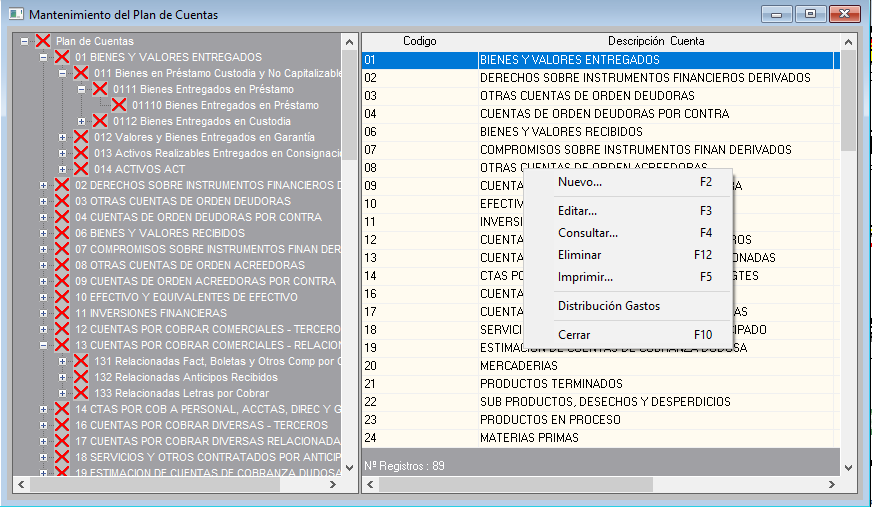
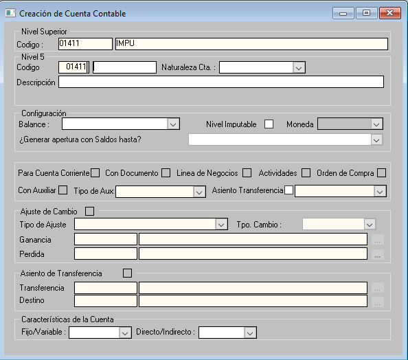
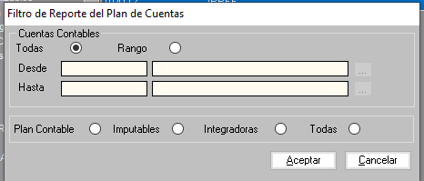
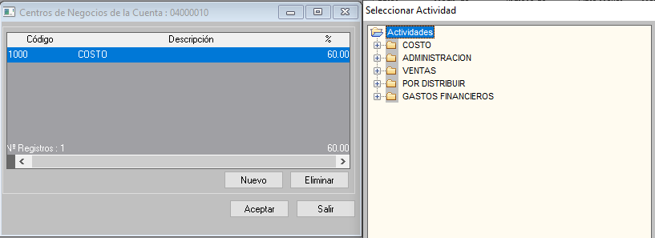

# Manual de Procesos del Plan de Cuentas

Este manual describe de forma práctica y visual las pantallas del sistema ERP y las acciones que los usuarios pueden realizar en el módulo de **Mantenimiento del Plan de Cuentas**.

---

## 1. Pantalla Principal: Mantenimiento del Plan de Cuentas

### Descripción de la Interfaz
Es la pantalla inicial del módulo contable. Está organizada en dos áreas principales:
* **Panel Izquierdo (Árbol jerárquico)**: Muestra la estructura de carpetas de todos los planes contables organizados por niveles (Elemento, Cuenta, Subcuenta, Divisionaria y Subdivisionaria).
* **Panel Derecho (Lista de cuentas)**: Muestra la grilla con las cuentas del nivel seleccionado, indicando su `Codigo` y `Descripción Cuenta`.
* **Menú de Opciones (Clic Derecho)**: Al hacer clic derecho sobre cualquier registro de la lista, se despliega el menú contextual con los atajos directos del sistema.

### ¿Qué puede hacer el usuario?
* **Navegar**: Hacer clic en los símbolos `+` o `-` del árbol para expandir y explorar las subcuentas.
* **Seleccionar**: Marcar una cuenta en la lista para verla o procesarla.
* **Acceder a las operaciones**: Puede usar el menú de clic derecho o pulsar directamente las teclas rápidas:
  * **`F2` - Nuevo...**: Abre el formulario para registrar una nueva cuenta.
  * **`F3` - Editar...**: Abre el formulario con los datos de la cuenta seleccionada para modificarla.
  * **`F4` - Consultar...**: Abre el formulario en modo de solo lectura para revisar sus datos sin modificarlos.
  * **`F12` - Eliminar**: Inicia el proceso de borrado de la cuenta seleccionada.
  * **`F5` - Imprimir...**: Abre la ventana de filtros para emitir reportes o imprimir el plan contable.
  * **Distribución Gastos**: Abre la configuración de centros de costos y actividades (requiere que la cuenta sea imputable).
  * **`F10` - Cerrar**: Cierra el módulo y regresa a la ventana principal del ERP.

---

## 2. Formulario: Creación, Edición y Consulta de Cuenta Contable

### Descripción de la Interfaz
Este formulario único gestiona el ciclo de vida de cada cuenta contable en el ERP y se adapta según la opción que elija el usuario:
* **Nuevo (`F2`)**: Abre el formulario en blanco con la jerarquía padre cargada para registrar una nueva cuenta.
* **Editar (`F3`)**: Abre el mismo formulario cargando todos los datos actuales de la cuenta para modificarlos.
* **Consultar (`F4`)**: Muestra exactamente el mismo formulario con los datos de la cuenta, pero con todos los campos bloqueados (solo lectura, sin permitir edición).

#### Secciones de la ventana:
1. **Nivel Superior**: Muestra el código y nombre de la cuenta padre seleccionada (campo fijo).
2. **Nivel 5 (Cuenta a registrar)**:
   * `Codigo`: Muestra el prefijo del padre y una casilla para escribir el dígito final del nuevo código.
   * `Naturaleza Cta.`: Permite seleccionar si la cuenta es **Deudora** o **Acreedora**.
   * `Descripción`: Casilla para escribir el nombre oficial de la cuenta.
3. **Configuración**:
   * `Balance`: Define en qué rubro de los Estados Financieros se consolida.
   * `Nivel Imputable` *(Check)*: Casilla obligatoria para permitir que la cuenta reciba asientos contables en el Libro Diario y se le pueda asignar Distribución de Gastos.
   * `Moneda`: Permite elegir si opera en Moneda Nacional (Soles) o Extranjera (Dólares).
   * `¿Generar apertura con Saldos hasta?`: Define el comportamiento para los saldos de apertura de fin de año.
4. **Parámetros Operativos**: Casillas para activar controles en comprobantes:
   * `Para Cuenta Corriente`, `Con Documento`, `Linea de Negocios`, `Actividades`, `Orden de Compra` y `Con Auxiliar`.
5. **Ajuste de Cambio**: Casilla para activar la fluctuación cambiaria y asociar las cuentas de ganancia y pérdida.
6. **Asiento de Transferencia**: Casilla para activar el amarre contable automático y definir la cuenta de `Transferencia` (ej. 79) y de `Destino` (ej. clase 9).
7. **Características**: Listas para clasificar si el gasto es `Fijo/Variable` o `Directo/Indirecto`.

### ¿Qué puede hacer el usuario?
* **Crear una cuenta nueva**:
  1. Digitar el dígito final del código y escribir la descripción de la cuenta.
  2. Elegir su naturaleza (Deudora/Acreedora) y tipo de moneda.
  3. Marcar la casilla **`Nivel Imputable`** si la cuenta va a recibir registros de vouchers.
  4. Configurar las casillas operativas que apliquen (documento, auxiliar, amarre de transferencia).
  5. Hacer clic en **`Aceptar`** para guardar la cuenta, o en **`Cancelar`** para descartar.
* **Modificar una cuenta (Editar)**:
  1. Cambiar el nombre, la moneda, activar o desactivar casillas de control.
  2. Guardar los cambios haciendo clic en **`Aceptar`**.
* **Consultar una cuenta**:
  1. Revisar los amarres y configuraciones de la cuenta con total seguridad de no alterar los datos.
  2. Hacer clic en **`Aceptar`** o presionar `Esc` para salir de la consulta.

---

## 3. Ventana: Confirmación de Eliminación de Registro

### Descripción de la Interfaz
Al pulsar la opción **Eliminar** o la tecla **`F12`**, el sistema no borra la cuenta directamente; abre un cuadro de diálogo de seguridad con el mensaje:

> **`¿Desea eliminar el registro?`**  
> `[ Sí ]` &nbsp;&nbsp;&nbsp;&nbsp; `[ No ]`

### ¿Qué puede hacer el usuario?
* **Confirmar la eliminación**: Hacer clic en **`[ Sí ]`** para borrar la cuenta seleccionada.
* **Cancelar la acción**: Hacer clic en **`[ No ]`** para mantener la cuenta intacta.
* **Reglas a tener en cuenta**:
  * El sistema **no permitirá** eliminar cuentas que tengan subcuentas dependientes dentro de su rama.
  * El sistema **no permitirá** eliminar cuentas que ya tengan asientos o movimientos registrados en la contabilidad.

---

## 4. Ventana: Filtro de Reporte del Plan de Cuentas (Imprimir)

### Descripción de la Interfaz
Ventana que se abre al presionar **`F5`** o seleccionar **Imprimir...** en el menú contextual. Permite definir qué cuentas se van a exportar o imprimir:
* **Cuentas Contables**:
  * `Todas`: Selecciona la totalidad del catálogo contable.
  * `Rango`: Permite delimitar un tramo específico mediante los campos **Desde** (cuenta inicial) y **Hasta** (cuenta final).
* **Tipo de Cuentas**:
  * `Plan Contable`: Reporta la estructura general.
  * `Imputables`: Muestra solo las cuentas operativas de último nivel que reciben asientos.
  * `Integradoras`: Muestra solo las cuentas acumuladoras / de balance.
  * `Todas`: Incluye tanto integradoras como imputables.

### ¿Qué puede hacer el usuario?
1. Elegir si desea imprimir todo el plan contable o marcar **Rango** e indicar las cuentas de inicio y fin.
2. Seleccionar el tipo de cuenta según el reporte que necesite (por ejemplo, marcar **Imputables** para auditoría de cuentas de trabajo).
3. Hacer clic en el botón **`[ Aceptar ]`** para generar la vista previa / imprimir el documento.
4. Hacer clic en **`[ Cancelar ]`** para cerrar la ventana sin imprimir.

---

## 5. Ventana: Distribución de Gastos

### Descripción de la Interfaz
Esta función permite repartir porcentualmente los importes de una cuenta de gasto entre distintas actividades o centros de negocios de la empresa.

> **Requisito obligatorio**: La cuenta contable seleccionada **debe tener activada la casilla `Nivel Imputable`** en su configuración; de lo contrario, la opción no estará disponible.

La interfaz se compone de dos pantallas:
1. **Pantalla Izquierda (`Centros de Negocios de la Cuenta`)**:
   * Muestra la tabla con las actividades ya asignadas a la cuenta.
   * Columnas: `Código`, `Descripción` de la actividad y el `%` (porcentaje asignado).
   * En la parte inferior muestra el número de registros y la suma total del porcentaje acumulado.
   * Botones de acción: **`Nuevo`**, **`Eliminar`**, **`Aceptar`** y **`Salir`**.
2. **Pantalla Derecha (`Seleccionar Actividad`)**:
   * Se abre al presionar el botón `Nuevo`.
   * Muestra el árbol de carpetas con las actividades disponibles en la empresa:
     * `COSTO`
     * `ADMINISTRACION`
     * `VENTAS`
     * `POR DISTRIBUIR`
     * `GASTOS FINANCIEROS`

### ¿Qué puede hacer el usuario? (Flujo Paso a Paso)

#### Para agregar una actividad y porcentaje:
1. En la lista principal de cuentas, seleccionar la cuenta contable imputable.
2. Hacer clic derecho y seleccionar **Distribución Gastos**: se abre la ventana izquierda con el listado actual.
3. Hacer clic en el botón **`Nuevo`**: se desplegará a la derecha la ventana **Seleccionar Actividad**.
4. En el árbol de la derecha, hacer clic en la carpeta correspondiente (`COSTO`, `ADMINISTRACION`, etc.) y seleccionar la actividad deseada.
5. Indicar el porcentaje (`%`) correspondiente y hacer clic en **`Aceptar`** en la ventana de la actividad.
6. La actividad seleccionada se agregará a la lista de la izquierda, sumando su porcentaje al total.
7. Volver a hacer clic en **`Aceptar`** en la ventana principal de la izquierda para guardar definitivamente los cambios.

#### Para eliminar o corregir una actividad:
1. Seleccionar la fila de la actividad que se desea retirar en la lista de la izquierda.
2. Hacer clic en el botón **`Eliminar`**.
3. El porcentaje asignado se descontará de la lista.
4. Hacer clic en **`Aceptar`** para guardar la lista actualizada.
